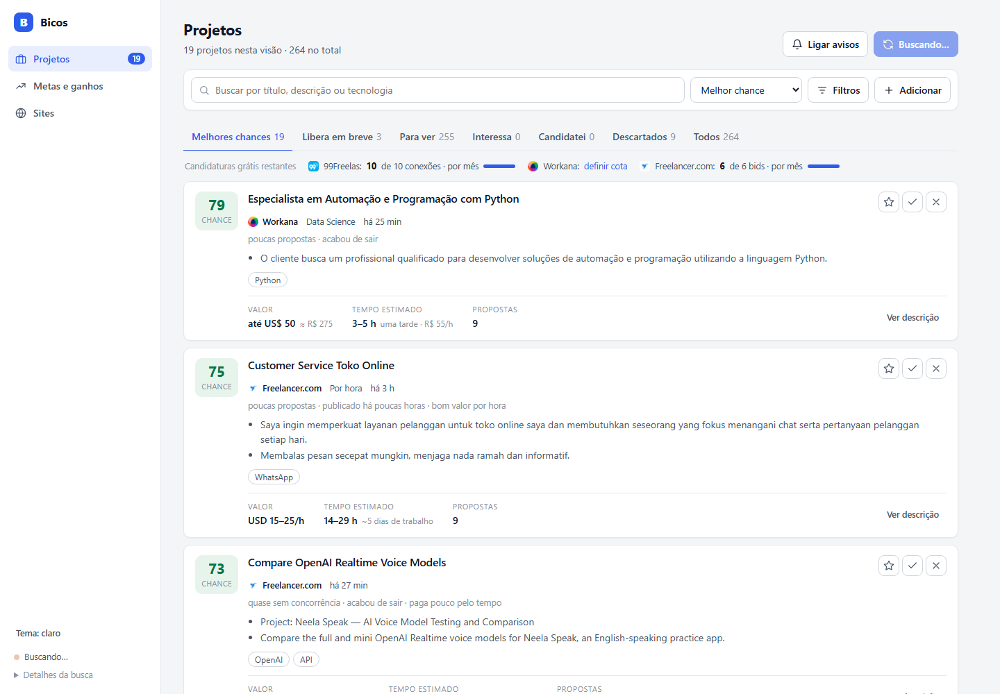

# Bicos

Painel local para encontrar freelas, acompanhar candidaturas e controlar metas de ganho mensal.
Python (só biblioteca padrão) + SQLite + uma página HTML sem build.



## Como usar

```
iniciar.bat            # sobe o servidor e abre http://127.0.0.1:8765
```

Telas (também acessíveis por URL): `#/projetos`, `#/metas`, `#/sites/cadastros`, `#/sites/politicas`, `#/sites/redes`.

## O que ele faz

- **Coleta sozinho a cada 10 min**: 99Freelas, Workana, Freelancer.com (API pública) e Reddit r/forhire.
  Só os sites ligados em *Sites* são consultados. Cada fonte falha isolada das outras.
- **Nota de chance (0–100)** por projeto: poucas propostas, recém-publicado, valor por hora estimado,
  tecnologias que casam com o seu stack, filtro de armadilhas (sem pagamento, permuta, comissão) e de área.
- **Cota do plano grátis** por site (99Freelas 10 conexões/mês, Freelancer.com 6 bids/mês, Workana semanal),
  contada quando você marca *Candidatei*; e **espera do plano grátis** (99Freelas: só propõe após 24 h).
- **Metas e ganhos** por mês, com histórico.
- **Políticas e planos**: resumo das regras de cada site, com fonte e grau de confiança, e uma calculadora de
  quando o plano pago se paga pela economia de comissão.
- **Redes sociais**: buscas prontas (LinkedIn, X, Facebook, Instagram, Telegram/WhatsApp via Google).
  Essas redes exigem login e bloqueiam robô, então só abrem a busca; não há coleta automática.

## Estrutura

| Arquivo | Papel |
|---|---|
| `servidor.py` | servidor HTTP, rotas `/api/*` e laço de coleta |
| `fontes.py`, `fontes_extra.py` | coletores (99Freelas, Workana, Freelancer.com, Reddit, link avulso) |
| `analise.py` | resumo, tecnologias e estimativa de horas (regras simples, sem IA) |
| `banco.py`, `metas.py` | SQLite: projetos, ganhos, metas, estado dos sites |
| `sites.json` | dados e regras de cada site (edite aqui para ajustar políticas) |
| `painel.html` | interface |

## Cuidados

- Os coletores leem só páginas/APIs públicas, com pausa entre requisições e `User-Agent` identificado.
  Se um site pedir verificação anti-robô, a coleta dele é pulada, sem tentar contornar.
- As regras de plano grátis em `sites.json` vêm de fontes públicas de terceiros e mudam: confira na sua conta.
- `bicos.db` (seus dados) não vai para o git.

## Por que existe

Feito para quem está começando como freelancer e não quer pagar plano de plataforma só para ver projetos novos
antes dos outros. O painel mostra onde vale gastar as poucas candidaturas grátis de cada mês.

Não precisa instalar nada além do Python 3.10+. Sem dependências, sem login, sem chaves.
